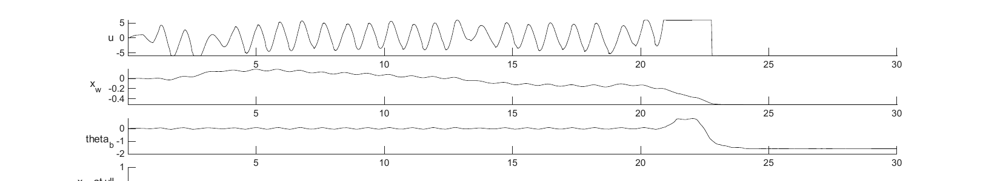
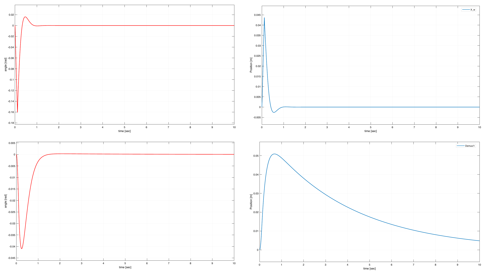
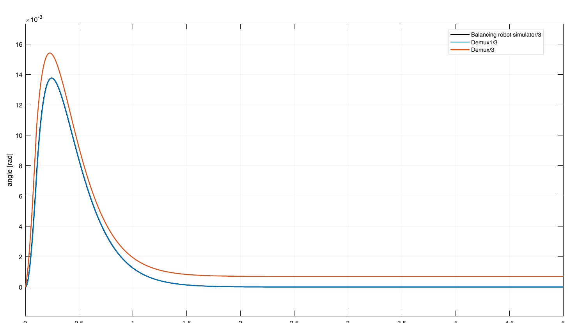
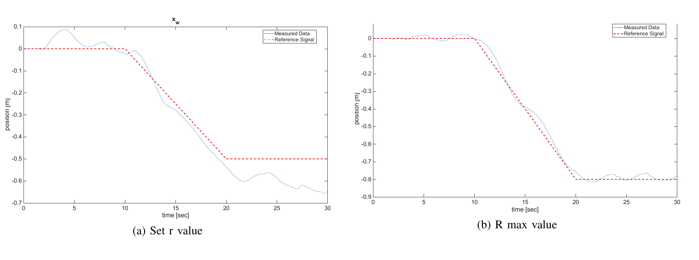

# Self-Balancing Robot: Modelling, State Estimation and Discrete LQR Control

Modelling and control of a **MinSeg self-balancing robot**, a wheeled inverted pendulum that has
to be actively stabilised through wheel torque. We derived the non-linear and linearised model,
then designed and compared four controllers on the **physical robot**: PID, pole-placement state
feedback, continuous-time **LQR**, and a **discretised LQR with full- and reduced-order Luenberger
observers**. Course: *Automatic Control* (R7003E), Luleå University of Technology, 2025–2026.

**Stack:** MATLAB · Simulink · Control System Toolbox · MinSeg (Arduino-based) hardware · LaTeX

📄 **[Read the paper (PDF, 6 pages)](paper/self_balancing_robot_lqr_paper.pdf)**

## Results on the real robot

| Controller | Outcome (30 s physical test) |
|---|---|
| PID | Balanced for about 20 s, then fell (around t = 22 s) |
| **Discrete LQR + Luenberger observer** | **Balanced for the full 30 s**, with motor voltage well inside the ±9 V limit |

- **Controllability and observability:** the model is fully controllable (rank 4) but only rank 3
  observable from the body angle alone. Measuring wheel position as well restores full
  observability.
- **Sampling-rate study:** the physical robot stayed balanced down to about **4.5 Hz**, well below
  the 47.6 Hz that the observer-inclusive simulation predicted. 200 Hz was chosen as the validated
  operating point.
- **Reference tracking:** a discrete reference compensator tracked ramp references up to
  0.08 m/s. It lost tracking on an aggressive sinusoid once the motor voltage neared saturation.

| PID on hardware: falls after about 20 s | LQR vs. pole placement (simulated) |
|---|---|
|  |  |

| Observer estimates vs. true body angle | Reference tracking on hardware |
|---|---|
|  |  |

## Repository layout

```
paper/self_balancing_robot_lqr_paper.pdf   final paper (IEEE format)
paper/latex/build/*.tex, paper/latex/fig/  LaTeX source and all figures
lab-reports/labA_modelling.pdf             equations of motion and linearisation
lab-reports/labB_pid_and_state_feedback.pdf PID, controllability/observability, state feedback, LQR, observer
lab-reports/labC_lqr_observer_discrete.pdf discrete controller and observer on hardware, reference tracking
matlab/minseg_model_and_pid.m              MinSeg parameters, state-space model and PID design
```

Build the paper with `cd paper/latex/build && pdflatex group_08_final_report.tex`.

## Team

Group 8: **Abdalrahman Nasser**, Fabian Dalenius and Kristoffer Liljendahl.
